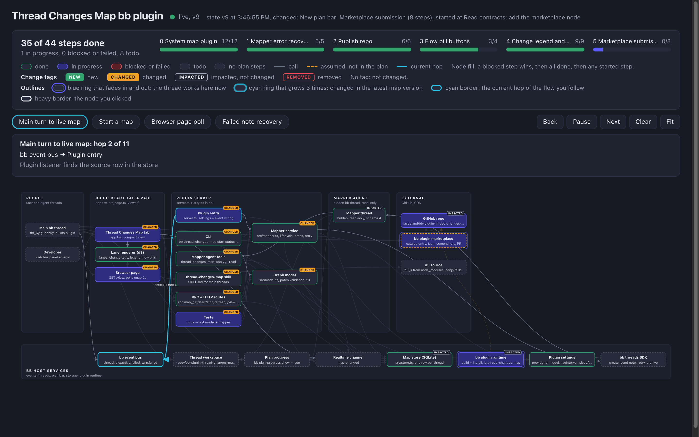

# bb-plugin-system-map

A bb plugin that gives a thread a live system design view. It starts a
hidden mapper agent for the thread and draws the map it keeps with d3, in
the thread's right panel and in a browser page.



*The map of the bb thread that built this plugin, drawn by its own mapper
agent while the thread worked.*

## Install

Requires bb 0.48 or later.

```
bb plugin install git:github.com/jaydeland/bb-plugin-system-map@main
```

bb builds the plugin on install. Every thread then has a **System Map** tab
in its right panel.

## Use it

1. Open a thread and select the **System Map** tab in the right panel.
2. Click **Start system map**. The mapper explores the workspace, reads the
   thread's plan bar (`bb plan-progress show`) and plan files, and draws a
   first map in a minute or two.
3. Keep working in the thread. The map changes after each turn, and during
   long turns.

The view is a whiteboard-style lane diagram:

- **Lanes**: columns for deployable or ownership boundaries (people, UI,
  services, external systems), and rows under them for shared services.
- **Plan progress**: "N of M steps done", one bar per phase, from the
  thread's plan. Each step links to the nodes it builds.
- **Node fill**: a blocked step wins (red), then all done (green outline),
  then any started step (indigo). Dashed: no plan steps. Dashed amber:
  assumed, not in the plan. A halo marks what the thread works on now;
  changed nodes pulse.
- **Flows**: pick a flow to follow a request hop by hop (Back, Pause, Next,
  Clear). The current hop is cyan, with its note in the hint bar.
- **Details**: click a node or an edge for its decisions, plan steps, edges,
  and files.

**Open in browser** shows the full view on its own page. In the side panel
the progress block folds to one line and flows are a select.

From a terminal or an agent: `bb system-map start|status|refresh|show|stop`
(`--thread <id>` for another thread, `--json` for JSON).

If the provider does not take an update note (for example, while it
restarts), bb sends the note again after 30 s and then 60 s. A turn that
starts and then fails is not retried; the next update note or **Refresh**
tries again.

**Cost and safety.** The mapper is a full agent session, so it uses tokens
for each update note. By default it runs on the thread's provider and model.
Set a cheaper `model`, or set `liveIntervalSeconds` to 0, to use fewer
tokens. The mapper is told to use only read-only commands. bb does not
enforce this: the mapper shares the thread's workspace and permission mode.

## Settings

`bb plugin config system-map set <key> <value>`

| Key | Default | Meaning |
| --- | --- | --- |
| `providerId` | empty | Mapper provider; empty uses the thread's provider |
| `model` | empty | Mapper model; empty uses the provider's default |
| `liveIntervalSeconds` | 90 | Least time between mid-turn notes; 0 sends notes only after turns |
| `sleepAfterMinutes` | 15 | Release an idle mapper's runtime; the next note resumes it |

## Layout

- `server.ts`: settings, the `system_map_apply` and `system_map_read` agent
  tools (mapper threads only), thread event wiring, RPC, HTTP routes for the
  browser page, and the CLI.
- `src/model.ts`: the graph model (lanes, nodes, edges, flows, phases, steps),
  atomic patch validation, and the derived node fill and progress. Pure code.
- `src/mapper.ts`: the mapper agent's lifecycle, prompts, and update notes.
- `src/store.ts`: one SQLite row per mapped thread.
- `src/page.ts`: the browser page.
- `viewer/graph-view.js`: the lane layout and d3 renderer, plus the progress
  card, flow player, and details bar. The panel (compact) and the page (full)
  share it.
- `app.tsx`: the thread tab.

## Develop

```
npm install
npm test          # model and mapper tests (node --test)
npm run typecheck
bb plugin build
bb plugin install . --yes
bb plugin dev     # rebuild and reload on save
```

The browser page is at
`/api/v1/plugins/system-map/http/view?thread=<thread id>` on the bb server.
It polls `/map` every 2 seconds and loads d3 from this plugin's
`node_modules` (or from cdnjs when that is missing).

Bump `MAPPER_SCHEMA` in `src/mapper.ts` when the tool schema or the mapper
instructions change. A running mapper keeps the schema it started with, so
`bb system-map start` replaces a mapper with an older schema and keeps the map.
